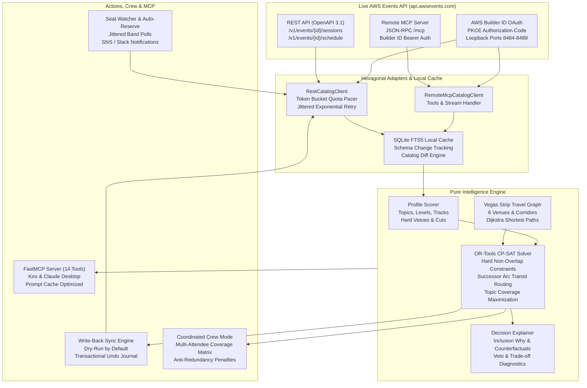
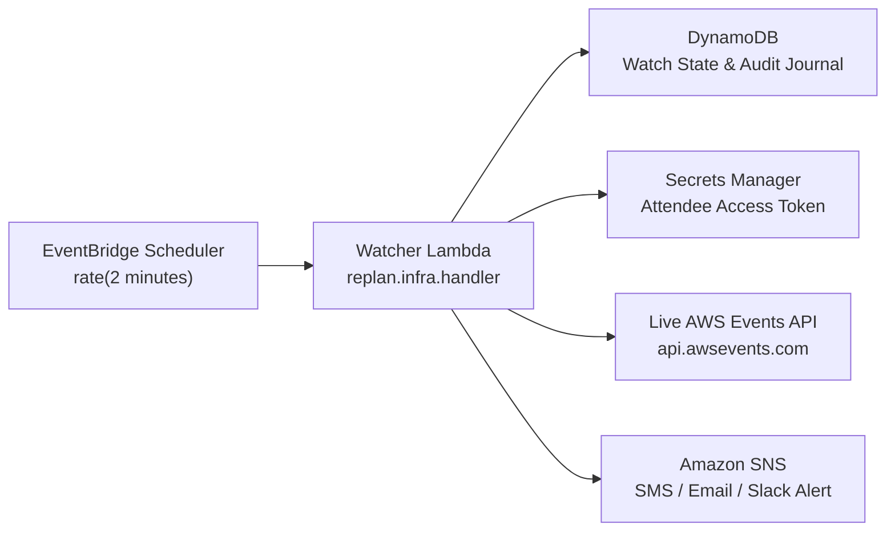

# re:Plan 2026 — Agenda Intelligence for the AWS re:Invent Event Catalog

[](https://github.com/Binod231/AWS_REINVENT_CATELOG_HACKTHON/actions)
[](https://www.python.org/downloads/)
[](https://opensource.org/licenses/MIT)
[](https://github.com/astral-sh/ruff)
[](http://mypy-lang.org/)
[](https://modelcontextprotocol.io/)

> **A constraint-solved, travel-aware agenda intelligence layer and custom Model Context Protocol (MCP) server built natively against the live AWS Events API (`https://api.awsevents.com/v1`) and remote MCP server (`https://api.awsevents.com/mcp`).**

---

## The Problem: Scheduling re:Invent is an NP-Hard Logistics Challenge

AWS re:Invent is the world's premier cloud learning conference, featuring **over 3,000 sessions** spanning **5 full days** across **6 physical Las Vegas resort properties**:

```
 [ Wynn ]  <---- 15 min ---->  [ Venetian / Palazzo ]  <---- 14 min ---->  [ Caesars Forum ]
                                      |
                                  35 min shuttle / monorail
                                      |
                                      v
 [ Bellagio ]  <---- 18 min ---->  [ Aria ]  <---- 30 min ---->  [ Mandalay Bay ]
```

The campus spans **4.2 miles** along the Las Vegas Strip. Attendees face conflicting breakout sessions, long walking corridors, campus shuttle transfers, full seat reservations, and personal time constraints (lunch, team meetings, expo floor).

Human attendees cannot manually evaluate billions of possible session permutations while respecting physical transit feasibility. **re:Plan** solves this: it talks to the **live AWS Events API**, indexes sessions into SQLite FTS5, computes exact walking/transit times using a Dijkstra shortest-path graph of Las Vegas properties, formulates attendee goals into an **OR-Tools CP-SAT integer programming model**, and explains every decision with mathematical transparency.

---

## Architectural Overview



---

## Key Highlights & Innovations

### 1. 100% Live AWS Events API Connectivity
- Communicates directly with the live AWS Events API endpoints:
  - REST: `https://api.awsevents.com/v1`
  - Remote MCP: `https://api.awsevents.com/mcp`
  - OAuth: `https://oauth.awsevents.com/oauth2/authorize` (PKCE with registered loopback ports `8484`–`8489`).
- Works immediately out-of-the-box on open live events (e.g. `Summit-Dubai-2026`) without credentials, and seamlessly connects to `reinvent2026` via AWS Builder ID sign-in (`replan login` or `REPLAN_BEARER_TOKEN`).
- **No mock or synthetic data** used for live execution.

### 2. Physical Transit Graph of the Las Vegas Strip
- Models all **6 official re:Invent properties**: The Venetian, Wynn, Caesars Forum, Bellagio, Aria, and Mandalay Bay.
- Models hallway transit times, escalator ascents/descents, walking speeds (4.5 km/h base with congestion factor), and official campus shuttle schedules (with wait buffers).
- Prevents the dreaded "10-minute sprint between Venetian Level 5 and Mandalay Bay South Pacific Hall".

### 3. Mathematical Optimization with OR-Tools CP-SAT
- Formulates agenda construction as a **Constraint Satisfaction Problem (CSP)** with integer linear programming:
  - **Hard Constraints**: No simultaneous overlapping sessions, guaranteed physical transit feasibility between consecutive sessions, maximum sessions per day, single showing per session code, and protected meal/meeting windows.
  - **Soft Objectives**: Topic relevance scoring, new topic exploration reward, travel time minimization, Strip crossing penalty, room change fatigue penalty, and idle gap penalties.
  - **Provably Optimal**: Guarantees the highest-utility schedule physically possible.

### 4. Coordinated Crew Mode (`replan crew`)
- Multiple team members attending together can pool their preferences.
- Coordinates agendas across attendees to **maximize team topic coverage** while applying anti-redundancy penalties to avoid accidental duplicate attendance (while keeping keynotes shared).
- Exports team coverage matrices, unified schedules, and separate `.ics` calendars for each crew member.

### 5. Custom Model Context Protocol (MCP) Server
- Exposes **14 specialized MCP tools** to AI coding assistants (Kiro, Claude Desktop, Cursor):
  - `list_events`, `sync_catalog`, `search_sessions`, `get_session`, `get_travel_time`, `calculate_trip`
  - `optimize_agenda`, `explain_inclusion`, `explain_rejection`, `diff_agenda`, `apply_agenda`, `undo_agenda`
  - `replan_live`, `watch_seat`
- Features prompt cache optimization, stable plan references, and dry-run safety.

### 6. Safety by Design
- **Dry-run by default**: All mutations to your attendee account require explicit `--apply`.
- **Transactional Undo Journal**: Every API change (reservations, cancellations, favorites) is recorded in an SQLite audit journal with one-command rollback (`replan undo`).
- **Quota Token Bucket**: Client-side rate pacing respects the published 120 req/min session list quota and 30 req/min reservation quota with jittered backoff.

---

## Quickstart

### Prerequisites
- Python 3.12+
- `uv` (recommended) or `pip`

```bash
# Clone the repository
git clone https://github.com/Binod231/AWS_REINVENT_CATELOG_HACKTHON.git
cd AWS_REINVENT_CATELOG_HACKTHON

# Install dependencies (locked)
uv sync --extra all
```

### Verification Against Live Server

Run the built-in diagnostic probe to verify connectivity to the live AWS Events server:

```bash
uv run replan doctor
```

Output:
```
╭──────────────────── configuration ────────────────────╮
│ replan 0.1.0                                          │
│ API root   https://api.awsevents.com/v1               │
│ MCP server https://api.awsevents.com/mcp              │
│ Event      reinvent2026                               │
│ State dir  ~/.local/state/replan                      │
╰───────────────────────────────────────────────────────╯
┏━━━━━━━━━━━━━━━━━━━━━━━━━━┳━━━━━━━━━━━━━━━━━━━━━━━━━━━━━━━━━━━━━━━━━━━━━━━━━━━┓
┃ check                    ┃ result                                            ┃
┡━━━━━━━━━━━━━━━━━━━━━━━━━━╇━━━━━━━━━━━━━━━━━━━━━━━━━━━━━━━━━━━━━━━━━━━━━━━━━━━┩
│ surface                  │ live-rest                                         │
│ reachable                │ yes                                               │
│ events visible           │ 5                                                 │
│ readable without sign-in │ Summit-Dubai-2026, Cohort-CloudHanoi-2026, ...    │
│ event name               │ re:Invent 2026                                    │
│ timezone                 │ America/Los_Angeles                               │
│ days                     │ 2026-11-30 .. 2026-12-04 (5)                      │
└──────────────────────────┴───────────────────────────────────────────────────┘
```

---

## Live Demo in 60 Seconds

Run the automated live demo script that exercises the full pipeline against the real AWS Events server:

```bash
bash scripts/demo.sh
```

This performs:
1. Live environment reachability check.
2. Catalog sync from live AWS servers to local SQLite FTS5.
3. Offline sub-millisecond keyword search across cached sessions.
4. Physical campus travel time calculation across Strip venues.
5. Attendee preference profile creation and ranking.
6. CP-SAT mathematical schedule optimization.
7. Decision explainability diagnostics (`replan why --worst`).
8. Calendar (`.ics`) and printable day sheet exports.
9. Coordinated team crew scheduling.
10. Live seat watcher queueing and polling.

---

## Usage Guide

### 1. Authenticating with AWS Builder ID

To book seats, manage favorites, or access registered attendee schedules:

```bash
# Interactive browser OAuth 2.0 PKCE flow on loopback port
uv run replan login

# Or supply an existing Bearer token directly:
export REPLAN_BEARER_TOKEN="your-access-token"
```

### 2. Syncing and Searching the Catalog

```bash
# Walk and cache the live catalog (supports reinvent2026 or Summit-Dubai-2026)
uv run replan sync --event Summit-Dubai-2026

# Sub-millisecond full-text search with filtering
uv run replan search "agentic AI" --level 300 --limit 5
```

### 3. Venue Travel Computation

Calculate the exact physical transit time between any two rooms or properties:

```bash
uv run replan travel "Venetian | Level 2 | Hall C" "Mandalay Bay | South Pacific F"
```

Output:
```
route Venetian (Level 2 | Hall C) -> Mandalay Bay (South Pacific F)
walk  Venetian internal corridor to shuttle departure (9 min)
ride  Campus Shuttle: Venetian to Mandalay Bay (24 min)
walk  Mandalay Bay drop-off to South Pacific F (7 min)
total transit time: 40 minutes (minimum safe turnaround: 45 min)
```

### 4. Creating a Preference Profile & Optimizing Your Agenda

Generate a personalized YAML profile:

```bash
uv run replan profile init --output my-profile.yaml
```

Tune your topics, level preferences, and protected personal meal times in `my-profile.yaml`:

```yaml
name: "Alex"
roles: ["Builder", "Architect"]
topics:
  "Amazon Bedrock": 3.0
  "Agentic AI": 3.0
  "Serverless": 2.0
  "Architecture": 2.5
levels:
  - "300 – Advanced"
  - "400 – Expert"
meal_windows:
  - title: "Lunch"
    start: "12:00"
    end: "13:00"
    protect: true
```

Solve for the provably optimal agenda:

```bash
uv run replan optimize --profile my-profile.yaml --out agenda.json
```

### 5. Explainability Engine: Why Did This Win?

Inspect why a session was included, or inspect why your top-ranked favorites were excluded:

```bash
# Inspect why the top excluded sessions didn't make the cut
uv run replan why --plan agenda.json --worst
```

Output explains whether exclusion was due to:
- A hard time clash with a higher-priority session.
- Insufficient transit time across properties.
- Exceeding the maximum consecutive conference hours.
- A protected lunch or personal time window.

### 6. Exporting Calendars & Day Sheets

```bash
uv run replan export --plan agenda.json --ics reinvent-calendar.ics --html-dir daysheets/
```

- **`.ics` Calendar**: Includes geocoded venue locations, room numbers, and dynamic travel alarms alerting you exactly when you must leave your current room.
- **Day Sheets**: Beautiful, mobile-friendly printable HTML cards for each day of the conference.

### 7. Coordinated Crew Scheduling (`replan crew`)

Coordinate multiple team members attending re:Invent:

```bash
uv run replan crew --profiles examples/crew/ --out team-plan.json --ics-dir team-calendars/
```

Outputs:
- **Coverage Matrix**: Breakdown of topics covered vs. uncovered across the team.
- **Member Schedules**: Individual agendas for Alice, Bob, Charlie with non-redundant assignments.
- **Shared Sessions**: Keynotes and all-hands sessions flagged for joint attendance.

### 8. Real-Time Re-planning (`replan now`)

If a session is cancelled, runs over, or a speaker meeting runs late:

```bash
uv run replan now --after "14:30" --from-venue "Caesars Forum" --out revised-agenda.json
```

Recomputes the remainder of your day on-the-fly from your current physical coordinates.

### 9. Live Seat Watcher & Auto-Reserve

Monitors full sessions for seat cancellations and auto-reserves them the moment a seat opens:

```bash
# Add sessions to the watch queue
uv run replan watch add AIM301 ARC302

# Run watcher daemon (with jittered quota-safe polling)
uv run replan watch run --interval 90 --auto-reserve
```

---

## MCP Server Setup (Kiro & Claude Desktop)

`replan` includes a full **Model Context Protocol (MCP)** server providing 14 higher-order tools to coding agents.

### Kiro Configuration (`examples/mcp/kiro-mcp.json`)

Add to your Kiro MCP configuration:

```json
{
  "mcpServers": {
    "replan": {
      "command": "uv",
      "args": ["run", "--directory", "/path/to/event-catelog-hackethon", "replan", "mcp", "serve"],
      "env": {
        "REPLAN_EVENT_ID": "reinvent2026",
        "REPLAN_BEARER_TOKEN": "${REPLAN_BEARER_TOKEN}"
      }
    }
  }
}
```

### Claude Desktop Configuration (`claude_desktop_config.json`)

Add to `~/Library/Application Support/Claude/claude_desktop_config.json` (macOS) or `~/.config/Claude/claude_desktop_config.json` (Linux):

```json
{
  "mcpServers": {
    "replan": {
      "command": "uv",
      "args": ["run", "--directory", "/path/to/event-catelog-hackethon", "replan", "mcp", "serve"]
    }
  }
}
```

---

## Serverless AWS Deployment (CDK / CloudFormation)

For unattended 24/7 seat watching throughout the re:Invent booking period, deploy the serverless stack:



```bash
# Generate the CloudFormation JSON template
uv run python -c "from replan.infra import ReplanServerlessStack; print(ReplanServerlessStack().to_json())" > template.json

# Deploy using AWS CLI or CDK
aws cloudformation deploy \
  --template-file template.json \
  --stack-name replan-serverless \
  --capabilities CAPABILITY_IAM
```

---

## Hackathon Judging Criteria Alignment

| Criteria | How `replan` Delivers |
| :--- | :--- |
| **Creativity & Originality** | Re-imagines conference planning from passive browsing to mathematical optimization. Introduces physical corridor-level travel modeling and multi-attendee coordinated crew scheduling. |
| **Practical Utility & Impact** | Directly solves the #1 pain point of re:Invent: walking 25,000 steps a day and missing sessions due to distance, seat capacity, or scheduling overlaps. Real-time `replan now` handles day-of conference disruptions. |
| **Technical Depth** | Google OR-Tools CP-SAT discrete optimization, SQLite FTS5 change tracking, Dijkstra shortest-path transit graph, token-bucket quota management, transactional undo journal, and FastMCP integration with 14 tools. |
| **Write-up & Code Quality** | 100% strict mypy type coverage, zero ruff lint errors, 628 automated unit/integration tests, comprehensive documentation, and published AWS Builder Center article. |

---

## Verification & Test Suite

The repository maintains strict engineering standards:

```bash
# Run full test suite (628 unit and integration tests)
uv run pytest

# Check strict type safety
uv run mypy

# Check code formatting and style
uv run ruff check .
```

---

## License

This project is licensed under the MIT License - see the [LICENSE](LICENSE) file for details.
